# osumania4k_replay_analyser

纯本地 osu!mania 4K 回放分析器。导入 `.osr` 就能看到逐击误差、失误归因、键型构成和打法建议；也能只拿一张 `.osu` 看难度。回放和谱面不会上传到任何地方。

支持 Windows，Stable 与 Lazer 导出的回放都读。便携版自带 Python 运行时，解压即用。

---

## 主要特性

### 分析这一局

- **逐击误差**：把回放里的按键帧和谱面音符逐一对上，给出每一击的毫秒偏差、分列分布与 UR。
- **判定还原**：按 mania 官方判定窗口判 MAX / 300 / 200 / 100 / 50 / MISS，规则按回放里的客户端版本自动选——stable 逐帧重演游戏的状态机，lazer 用它自己的窗口和按键归属。判定分布与游戏记录基本逐档一致。
- **失误归因**：每个失误给出四类原因之一（超出能力范围 / 节奏感弱 / 分神 / 随机失手），附打分依据和次要成因。
- **键型分类**：细分到 stream、jumpstream、handstream、jack、trill、anchor 等 14 类（部分细分仍在调，见「注意事项」）。
- **总体评价**：等级、一句话结论、分段表现、左右手对比、最吃亏的键型、稳定上限，以及几条具体建议。
- **简易报告**：段位在 Reform 3 及以下的回放只留总览、谱面难度、亮点与短板和几条建议——亮点 / 短板只说准确率、误差、连击、整局偏移这些手上能感觉到的事，建议按成绩分档，逐点分析的页签收起来。
- **相似谱面推荐**：每份回放给出五张键型构成最接近、段位也最接近的谱面，附段位差与一键下载。

### 看和听

- **跟曲重放**：播放谱面原声并渲染下落音符，支持 0.5×~1.5× 变速（只改谱面时间轴，下落速度按设定不变）、只看失误、两路并排对比、点选失误物件直接看原因。
- **打击音**：回放时可以听到每一下击打的声音，可切换「正解音」（按谱面要求的时间响）和「实际击打」（按你真正按下的时间响）
- **成绩卡**：总览右上角一键把这一局压成一张竖版图（官方评级、准确率、段位、最大连击、整局偏移、失误构成），直接发群；图上是 osu! 官方评级，不是本程序的评价等级。导出的图会存到程序目录下的 `card/` 文件夹，文件名是「序号_曲名_SV1 或 SV2_日期」，其中 SV1 / SV2 表示这张卡按哪套判定口径算的。
- **判定口径可切换**：顶部栏的 V1 / V2 随时切换。V1 按 stable 的合并口径，V2 按 ScoreV2 的头尾分判（尾窗口 1.5 倍）。切换只是换一套统计口径、不会重新分析，播放器颜色、失误清单、准确率、时间轴与评语一起变，刷新后保持选择。

### 练习

- **网页跟打**：在回放页点「跟打」，用键盘跟着当前谱面打一遍。键位可改（默认 D/F/J/K），下落速度按 25ms 一档调，判定窗口按谱面的 OD 算、和游戏一致；开局先停三秒倒数，打中的音符立即消失、按键有打击音，屏幕中心偏上会按判定档弹一颗色点。退出或打完时给准确率、六档判定和最大连击。只对 Reform 4 及以下的谱面开放。
- **倍速切片**：建议里点一下就能生成练习谱面——薄弱段落向外扩到最近的整八拍、开头补 3 秒空白、音频一起变速，导出成 `.osz` 直接并进原曲包，难度名带 `Slice` / `Rate` 前缀方便事后批量删。倍率按段位给：Reform 10 及以下只有 0.9×，Alpha~Gamma 是 0.95× 与 0.9×，Delta 以上是 0.96× 与 0.92×，每一档都单独给估算段位。
- **提速练习**：V1 准确率 98.5% 以上时反过来给提速版——Reform 10 及以下整曲 1.1×，Alpha~Gamma 给 1.05× 与 1.1×，Delta 以上只给 1.05×，这时不再出降速与分段复练的建议。
- **改进建议**：最多三条，同一类的合并成一条主建议，点建议里的时间直接跳到回放的那一段。

### 长期追踪

- **成长页**：把程序存下的每一局折成段位，估你离下一个段位还差多少。展开 B50 后点任意一格，可以回到那一局的分析页；回放文件被删掉会提示「回放不存在」。
- **段位变动**：每次导入回放后，总览页「本局」那张卡片上会多出一小张，写明这一局让综合段位从多少变到多少、差了几段——上升是绿卡、下降是红卡。成长页样本还不够时（本来就不出段位）不显示。
- **导出 B50**：成长页右上角一键把综合段位与计入评估的 50 局导成一张竖图，配色跟随深色 / 浅色主题，V1 准确率超过 99% 的成绩标金，超过当前目标段位的另有一套样式；图片存到程序目录下的 `card/` 文件夹，文件名是「B50_玩家名_日期」
  - **综合 b50**：同一张谱面只算最好的一局（不重复计入），再取最好的 50 局，按「谱面段位 + 准确率偏移」折算后加权平均（中间偏上的几局权重最高）。91% 以下的成绩不进评估。
  - **分键型 b10**：叠 / 技术 / 速度 / 耐力四类各取最好的 10 局，单独给评估值。
  - **段位刻度统一**：本程序按照 Alpha = 11、Beta = 12、Gamma = 13，依次类推计算；也支持将Malody段位转换成Reform段位
  - 段位谱、综合考核这类「没有主导键型」的图只进综合 b50，不参与分键型 b10（具体规则是如果某张图的主键型占比小于45%则不进入分键型b10）

### 其它

- **关于页更新说明**：历次版本改了什么都在这一页，按版本倒序、点开看；内容直接读仓库里的 `CHANGELOG.md`，不会和实际发布脱节。
- **只看谱面**：手里只有 `.osu` 时也能看难度与键型——综合 MSD、段位估计、整图类型、键型构成与雷达图，不读回放、不算成绩。
- **快捷导入**：打完按 `Alt + F5`，直接分析「刚刚导出的那份回放」，不用翻文件夹，也不用拖文件。快捷键可以在设置里改或留空关掉。
- **难度与段位**：MinaCalc 算 MSD 与七维雷达图；段位按谱面类型选算法——RC 图优先 Roxy（数值 11~17），超出范围或被拒绝时回退 Azusa，再回退 Sunny；面图仍用 Sunny 的 LN 标尺，长条图给「RC 段位 || LN 段位」两条。界面会标明用的是哪一个，开 DT / HT 时按实际倍率下的密度计算。
- **音频在线补齐**：只在 lazer 里下载过的谱面本地没有音频，程序会按图集 id 去镜像站取一次谱面包，只留下音频并缓存。补的时候右上角会有一条「补音频」进度条，写着下到多少、当前是下载还是校验。
- **随机找图**：选常规或面条段位 + 键型，自动推荐 ±1 段的 8 张图；点封面直接下载 `.osz`。
- **锚度**：叠（stack）与切（cut）两类写法各给一个锚度，写明是第几张 / 共几张、覆盖率、平均链长与最大链长。两套口径不同，只能同类之间比。
- **本地回放搜索**：`_replays` 目录里的回放多了以后，导入页可以直接按文件名搜。
- **纯本地、免安装**：只监听 `127.0.0.1`，便携版自带 Python 运行时，不装任何东西。


## 快速开始

### 使用便携版 zip（推荐）

1. 前往 [Release](https://github.com/SWt0619/osumania4k_replay_analyser/releases/latest) 下载 `osumania_replay_analyser-1.9.1-win64.zip`。
2. 解压到任意位置。
3. 双击 `启动分析器.exe`。它会静默起服务，不弹任何窗口。
4. 浏览器会打开 `http://127.0.0.1:8806/`。端口被占用时程序会自动往后找一个空的。
5. 从游戏里导出回放，Stable 与 Lazer 都可以。
6. 把 `.osr` 拖进网页。程序读回放头里记的谱面 MD5，去你的曲库里找，找不到会弹窗让你手动选 `.osu` 或按曲名搜。

### 使用单文件 exe

不想开服务、只想要一份报告的话，单文件 exe 可以独立工作：

1. 下载或自行构建 `osumania_replay_analyser.exe`。
2. 双击 → 后台起服务并打开网页，没有黑窗口。再运行一次会问：选「是」打开页面，选「否」停止服务。
3. 把 `.osr` 拖到 exe 上 → 不开服务，直接生成一份自包含的 HTML 报告（样式、图表、数据全塞在一个文件里，双击就能看，也能直接发给别人），落在 exe 旁边的 `报告\`。

首次启动要多花一两秒解压（PyInstaller 的单文件机制），个别杀毒软件会对未签名的 PyInstaller 程序报可疑，介意的话用上面的 zip 版。

### 从源码运行

1. 需要 Python 3.10+（Windows x64）。
2. 在项目根目录执行 `python app\server.py`。
3. 浏览器打开 `http://127.0.0.1:8806/`。
4. 跑测试：在项目根目录执行 `python -m unittest discover -s tests -t .`（标准库 unittest，零第三方依赖）。

源码本身零第三方依赖，只用到标准库。`python\` 里那份内置运行时只是给便携版用的，源码运行不必理会它。

## 功能介绍

### 导入回放

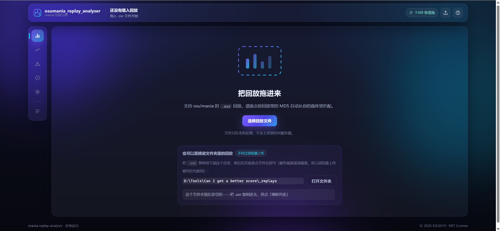


可以点击按钮选择 `.osr`，也可以直接把文件拖进页面。初次启动时程序会尝试查找 osu! 目录，没找到也可以手动指定。

装好之后更常用的是快捷导入：打完按 `Alt + F5`，程序自己找刚刚导出的那份回放。

### 总览

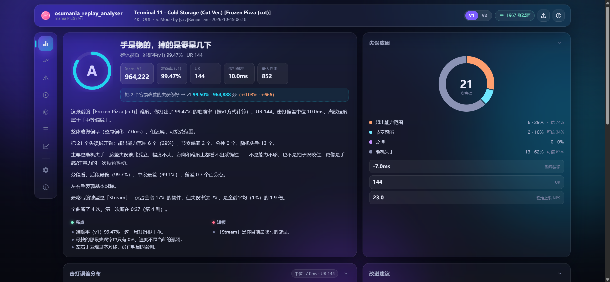

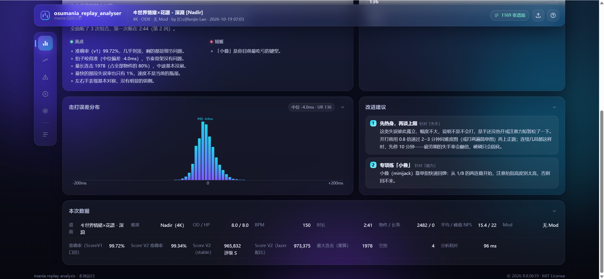

看本局详细信息和给出的分析，下方推荐 5 张相似谱面。偏差直方图是 lazer 同款，顶上标着这一局的整局偏移。

### 时间轴

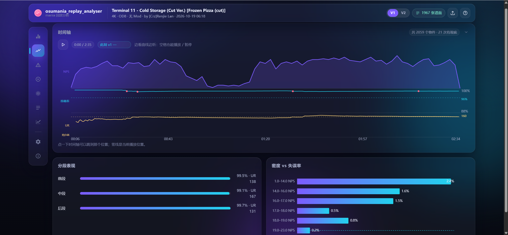

用于直观了解谱面密度、准确率变化、UR 变化，以及分段准确率与 UR。准确率 88% 以下统一表现为触底。

### 错因分析

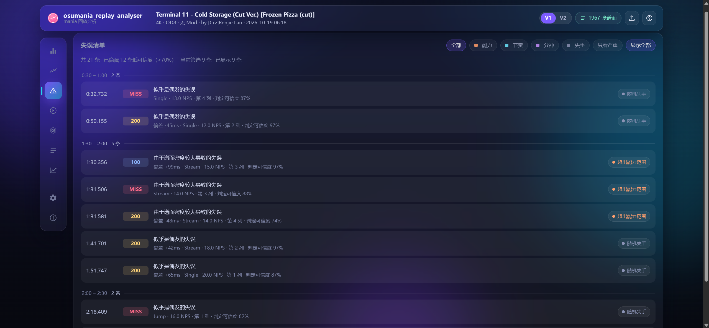

通过算法分析本次错误可能的原因，分为随机失手 / 分神 / 节奏感弱 / 能力不足四大类，同时给出可信度。可以按类别筛选，点对应项跳到回放的相应位置前。没把握的失误可以一键收起来。

### 回放

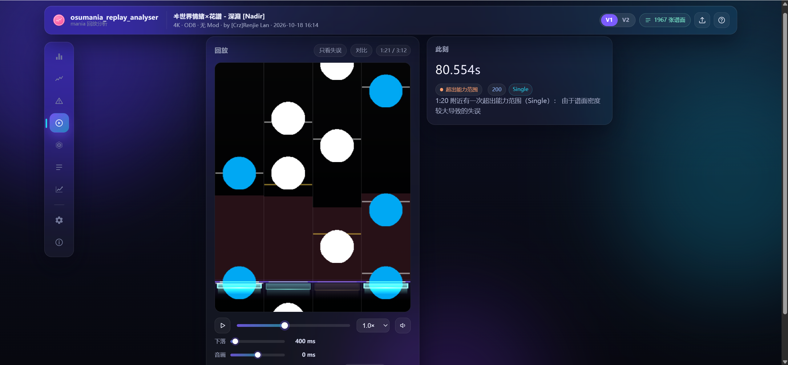

用于详细分析失误前后发生了什么。轨道下半部分的暗红色条代表当前该轨的平均偏差。

右侧「此刻」下面的设置卡里可以打开打击音：选「正解音」听的是谱面要求的时间，选「实际击打」听的是你真正按下的时间。两者叠在一起，偏早偏晚一听就知道。打击音量最高 300%，音乐音量仍然 100%。下落速度、音画偏移、音量也在这张卡里，画布因此能占满整个高度。变速播放时音符仍按设定的下落时间走，不会跟着快慢。

回放帧率上限可以在设置里选 30 / 60 / 90 / 120 / 180 / 240 帧或「无限制」，默认 120；性能跟不上时程序会自动降低一档。跟打也按这一档排帧，不会在 144 / 240Hz 屏上白白多画。

右上角的「跟打」可以在网页里直接打这张谱面：开局先停三秒倒数，判定用这张图的 OD 算出来的 stable 窗口；打中的音符立即消失，屏幕中心偏上按判定档弹色点（白 MAX / 黄 300 / 绿 200 / 蓝 100 / 紫 50 / 红 MISS）。键位在右侧设置卡里改，下落速度也能按 25ms 一档调，退出时给这一局的准确率、六档判定与最大连击。跟打只对 Reform 4 及以下的谱面开放。

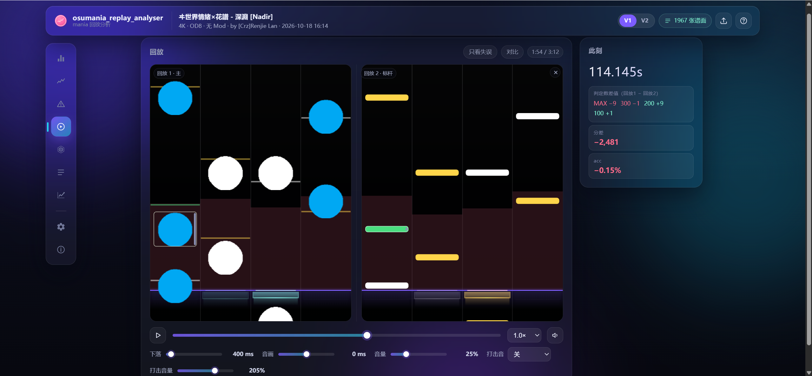

可以点击对比按钮导入第二份 `.osr`（需要同谱面），用来分析你与其他玩家 / 你和你的其他记录之间的差距（也可以用来赛博斗蛐蛐）。

### 谱面难度分析

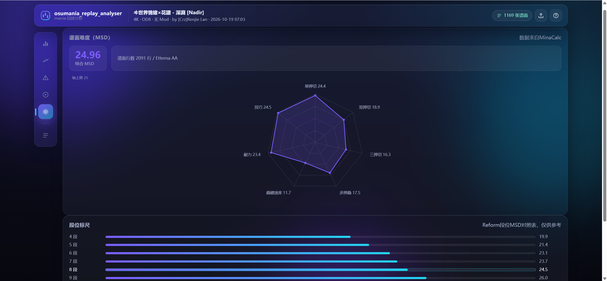

只拖一张 `.osu` 也能看：综合 MSD、七维雷达图、参考段位、整图类型与键型构成。

长条多的图会给两个段位，形如 `Reform 5 mid/high || LN 6 low`，左边按常规键型算，右边按长条算。启用 DT / HT 时，难度计算也会相应受到影响。

### 细节数据

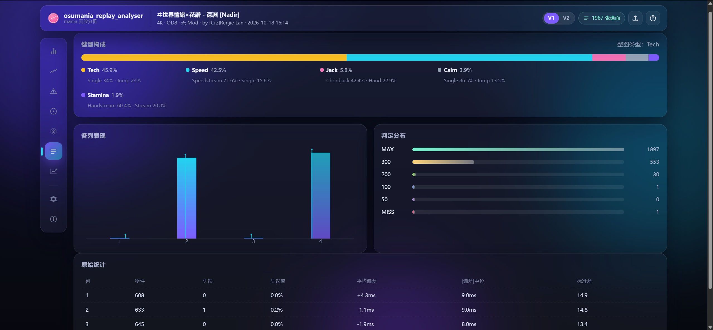

查看谱面键型构成，还可以查看每列的失误数量、平均偏差。如果是LN Hybrid还支持查看每个轨道的平均松手时间偏差

### 随机找图

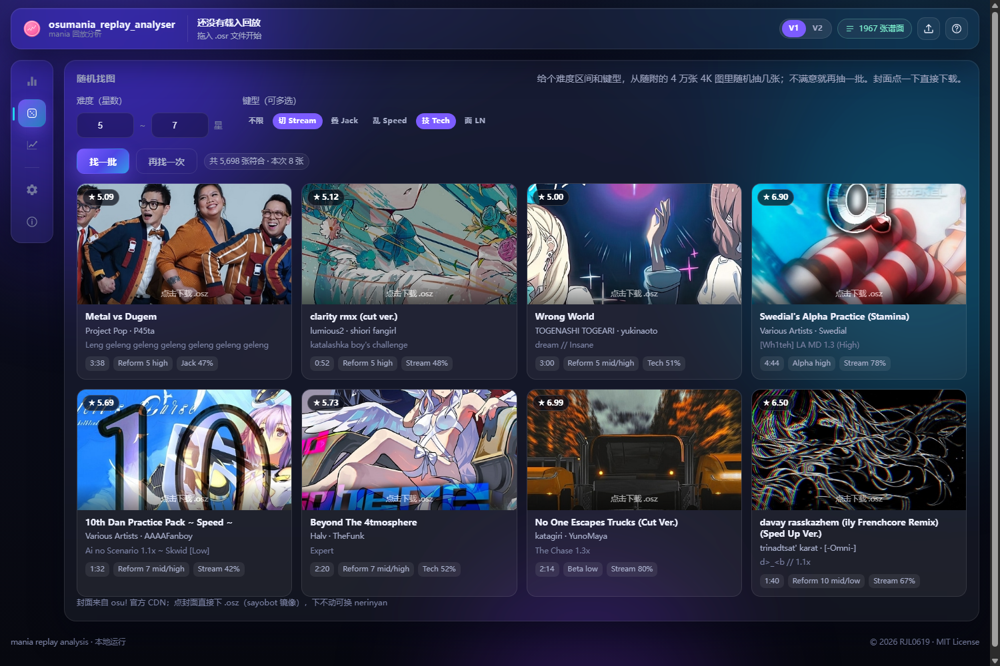

只想找几张图练、又没有具体目标时用它：选好**类型**（常规 / 面条）、**段位**和**键型**，程序会从随附的
4.8 万张 2018 年后 4K 图里抽出这个段位上下各一段的 8 张，并按段位排好。

- **常规**按 RC 段位（Intro 1 ~ CloverWisp Theta），**面条**按 LN 段位（LN 5 ~ Lnlism LN 17）。
  两者互斥：面图的 RC 段位和 LN 段位能差好几段，混着筛一定挑歪。面条模式只给长条占一半以上的图，
  键型选项会自动变灰——面图的主键型本来就是长条。
- 段位取 **±1 段**：选 Reform 6 就是 5~7 段，选 LN 7 就是 LN 6~8。改任何一项都会立刻重新抽，
  「再找一次」是同一条件下换一批；±1 段里凑不够 8 张时会自动放宽，并在下方注明放宽到了多少。
- 卡片左上角是段位、右上角是星数，底部是时长、段位名称与键型占比（面条模式显示长条占比）。
  **点封面直接下载 `.osz`**（sayobot 镜像，下不动可以在悬浮提示里换 nerinyan）。

封面来自 osu! 官方 CDN，断网时会显示底色，不影响筛选和下载。

### 成长

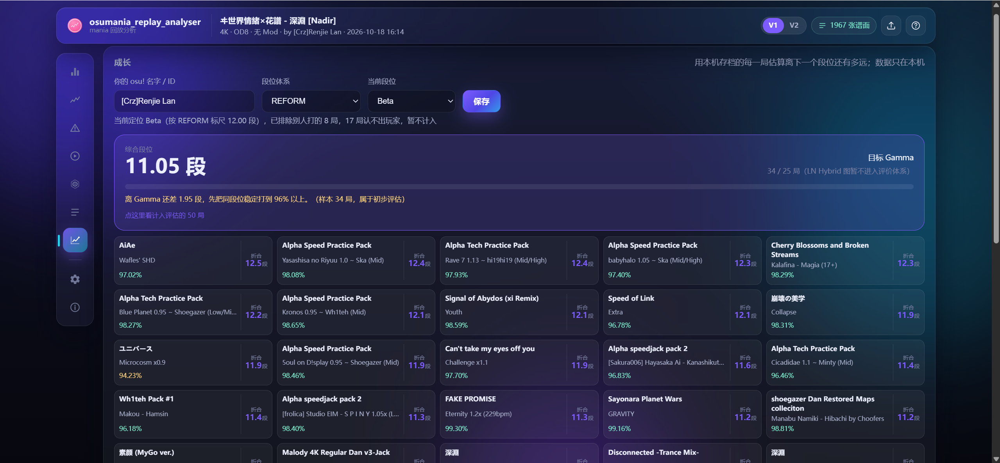

选一个当前段位保存，之后每导入一局都会自动记档。页面顶部是综合段位（每张图取最好一局，再取最好的 50 局）和目标进度条，下面是叠 / 技术 / 速度 / 耐力四类的独立评估。

点综合卡片展开成 5×10 共 50 格，逐张写着歌名、难度名和 V1 准确率，右侧标着这一局折算成多少段；点练法卡片则展开该类实际计入的 10 局。鼠标停在格子上能看到它为什么没进单键型评估（比如「键型分散，最高 Jack 32%」）。

> 折合规则：V1 准确率 96% 为过段线，91% 以下的成绩不进评估；准确率与段位的换算按一张对照表插值，不再是直线；Alpha 之后上下限按段位收窄。

### 设置

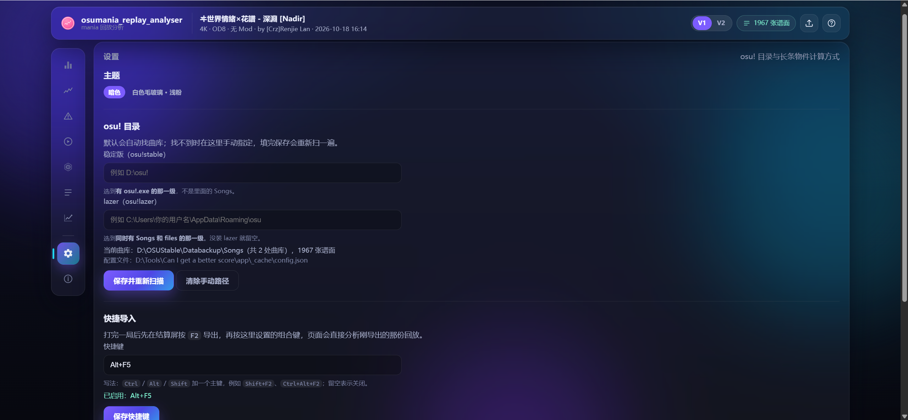

曲库路径、快捷导入的快捷键、打击音音量、是否自动补音频、主题切换、镜像站测速都在这里。路径保存后立即重新扫描，不用重启；「测试连接」会量一次本机到几个镜像站的延迟，只发探测请求，不下载谱面包。

## 注意事项

1. **DT / HT / Mirror**：回放帧时间和谱面时间在同一条时间轴上，所以误差值不用换算；UR 按官方口径除以倍率（lazer 把 DT 调到 1.35× 这类自定义倍速，就按 1.35 算）。开了 Mirror 的回放会先把按键的左右键位翻回来再配对，分列统计仍然按谱面原本的列号。
2. **判定规则跟着客户端走，V1 / V2 只是展示口径**：stable 的回放按 stable 的逐帧状态机算，lazer 的回放按 lazer 自己那套算（头、尾、体三段分开，尾判在真正跨过结尾的那次松手才结算），设置里没有开关，也不用选。顶部栏的 V1 / V2 切的是同一局的两套统计口径，不会重新分析。体中松过手会把结果封顶在 MEH；松到尾部窗口之外、或松得太晚才算 MISS。面图的判定分布可能与游戏差几个音符（实测 36 张 stable 回放全部相同，118 张 lazer 回放里 77 张完全相同、最差 0.12 个百分点）。长条只按头部判定键形。
3. **准确率的两个数不是一回事**：顶栏的「击打偏差」是每次击打偏离目标的幅度（取绝对值），正文的「整局偏移」是带正负号的中位数（整体偏早还是偏晚）。有早有晚时整局偏移可能接近 0，但每次击打照样偏了十几毫秒。
4. **启发式归因**：四类的边界在真实数据里会重叠（尤其「能力 + 节奏」双重），所以每条结论都带可信度，可信度低时请当成「两种都有可能」。
5. **谱面版本对不上**（比如谱面后来被更新过）时 MD5 会查不到，程序会在「本次数据」里如实标注。
6. **提示「数据不完整 / 解压失败」**：多半是游戏还在往 `.osr` 里写就把文件拖进来了。等游戏完全退出再拖一次即可。
7. **音频不在本地时会联网补一份**：只在 lazer 里下载过的谱面，本地配不上音频。程序会读谱面里记的图集 id，去 **[sayobot](https://osu.sayobot.cn)** 取一次 `.osz`；国内优先 sayobot，取不到再依次试 nerinyan、catboy。取回后只把 `AudioFilename` 指向的文件存进 `app\_cache\audio\`，其余丢弃。请求串行、间隔至少 2 秒，失败会记账并在 7 天后才重试。**这需要联网，并且会把图集 id 发给镜像站**；不希望联网的话，在 `app\_cache\config.json` 里写 `{"autoFetchAudio": false}`，但会导致 lazer 端导出的回放没有音乐。
8. **找不到曲库时**：点右上角的曲库标签，可以手动指定目录。稳定版填到**有 `osu!.exe` 的那一级**（不是里面的 Songs），lazer 填到**有 `client.realm` 和 `files` 的数据目录**（现行 lazer 没有 `Songs`，谱面都在 `files` 里），填错会当场提示是哪一栏不对；保存后立即重新扫描。
9. **只支持 osu!mania 4K**：试图导入其他键数 / 其他模式的谱面都会被拒绝。
10. **同一时间只会跑一个实例**：再点一次 `启动分析器.exe`，如果已经有一个在跑，会直接打开它的页面然后退出。要停就点 `停止分析器.exe`。
11. **关掉网页，服务会自己退出**：页面每 10 秒报一次到，关标签页后 8 秒左右进程结束（切到别的窗口不会误退，超时留了 75 秒）。调试时加 `--keep-alive` 可以常驻。
12. **真出问题时先看 `crashreport\`**：页面提示「服务器内部错误」时，程序目录旁的 `crashreport\` 下会有一份 `crash-日期-时间-pid-指纹.txt`，里面有版本、系统、请求、完整堆栈和 `server.log` 的最后 60 行。提 issue 时一起发过来（同一处堆栈只写一份，最多 50 份）。
13. **检查更新会请求 GitHub**：只有打开「关于」页或点「检查更新」时才请求一次 latest release，不上传任何本地数据；5 分钟内不重复。没网时只显示「检查失败」，不影响其他功能。
14. **浏览器要开硬件加速，别用节能模式**：回放是每帧重绘一块画布，一旦浏览器回落到软件渲染，播放会掉到个位数帧率（同一台机器实测 198fps → 5fps）。检查方法：地址栏打开 `chrome://gpu`（Helium 用 `helium://gpu`），看 `Compositing` 和 `Rasterization` 是不是 `Hardware accelerated`；如果写着 `Software only. Hardware acceleration disabled`，就是这个原因。

## 性能与排错

- **第一次启动时曲库索引会存到硬盘**（`app\_cache\library_index.json`），所以启动时间可能会较长，第二次启动就可以复用索引了。之后新下载的图会在导入时自动重扫，不必重启。
- **上传被挡时有备用通道**：把 `.osr` 放进项目下的 `_replays\`，页面空白时会自动列出来，点文件名就由服务端直接读硬盘分析，整条上传链路都绕开了。上传失败时页面也会给「打开文件夹 / 刷新列表 / 重试上传」三个按钮。
- **日志在 `app\_cache\server.log`**（exe 形态在 exe 旁边的 `_cache\server.log`）：每个请求一行 `[http] … -> 状态码`，音频补齐、曲库索引、启动与多开检测也都记在这里。

## 目录

```
app/
  server.py            本地服务（只监听 127.0.0.1，8806 起自动找空端口）
  version.py           版本号（只有这一处，HTTP 头与接口都引用它）
  core/
    osr.py             .osr 解析（文件头 + LZMA 帧 + 按键位掩码 → 按下/松手事件）
    beatmap.py         .osu 解析（mania 列号、长条、判定窗口）
    match.py           击打 ↔ 音符配对与判定
    mania_engine.py    stable 的逐帧判定引擎（状态机、长条体、连击 tick）
    lazer_engine.py    lazer 的逐帧判定引擎（头 / 尾 / 体三段）
    practice.py        倍速切片（按八拍裁段、音频变速、打包 osz）
    anchor.py          锚度（叠 / 切两套口径与分位表）
    metrics.py         统计工具（UR、游程检验、CUSUM、分箱、分位数）
    patterns.py        每个音符的局部上下文（密度、和弦、连打、交错、细分）
    attribution.py     失误归因（打分 + 理由 + 次要成因）
    report.py          总体评价文案与预估值
    progress.py        成长评估（折合段位、综合 b50、分键型 b10）
    msd.py             MSD 难度（调用 vendor 里的 MinaCalc）
    dan.py             MSD → 段位的对照表（段位主路径由前端估算，这里作兜底与标尺）
    library.py         曲库索引（按 MD5 找谱面、找音频）
    osu_dirs.py        曲库/导出/文件库的默认路径
    skin.py            读 osu! 皮肤素材（长条贴图等）
    analyze.py         串起来，输出一份 JSON
    recommend.py       相似谱面推荐（段位 + 键型构成，查 data 下的本地索引）
    finder.py          随机找图（按段位与键型抽一批图，给下载直链）
    segment_match.py   按段匹配的算法与索引读取（框架，页面入口尚未接）
    history.py         每局摘要的本地存档（SQLite）
    replay_store.py    回放存档：B50 点开一局时按 MD5 找回当时的 .osr
    release_notes.py   关于页的更新说明（直接读仓库里的 CHANGELOG.md）
    audio_fetch.py     本地没有音频时去镜像站补（只留音频，其余丢弃）
    quick_import.py    快捷导入（找最新导出的回放）
  web/                 前端（原生 JS，零构建）
    js/estimator.js    段位估算的封装：前端跑 Sunny → Azusa → Roxy，再查 RC / LN 两张标尺
    js/hitsound.js     打击音（hihat 采样 + 独立音量）
    js/practice.js     倍速切片入口（按段位给倍率、生成与下载）
    js/sharecard.js    成绩卡与 B50 导出（Canvas 绘制，配色跟随主题）
    js/download.js     谱面包下载（服务端分段并发，页面只轮询进度）
    js/player.js       回放渲染、打击特效、打击音触发
    audio/hihat.wav    打击音采样
    vendor/mma/        第三方算法与段位表（MIT，原样复制，说明见该目录 README）
  _cache/              曲库索引缓存、端口号、server.log、history.db（每局摘要）
python/               内置的 Python 3.13 运行时（Windows x64，免安装）
tests/                回归测试（合成 .osr / .osu，不依赖真实曲库）
packaging/            构建脚本（exe / zip / 启动器）
packaging/icon/       图标源文件与 app.ico（生成脚本 make_icon.py）
docs/                 方案文档（BPM 整数倍归一化思路）
vendor/minacalc/      MinaCalc（算 MSD 难度用的 DLL）
data/dan_scale.json    段位对照表（MSD → 段位，兜底与标尺）
data/malody_dan.json   Malody 段位谱实测表（段位谱丢进算法跑出来的换算值）
data/dan_rank.json     段位顺序表（Intro 1 ~ CloverWisp Theta 共 105 档，推荐按它算段位差）
data/similar_index.json 相似谱面的候选库（2018 年后、人气达标的 4.8 万个 4K 难度 / 1.06 万个谱面集）
crashreport/           真出问题时生成的标准格式崩溃报告（本机排障用，不进仓库也不进发行包）
_dataset/              重建上面两个 data 文件的工具链（爬取 / 跑分 / 建索引，见该目录 README）
img/                   README 用的界面截图
报告/                   exe 拖拽模式生成的自包含 HTML 报告
card/                   导出的成绩卡与 B50（成绩卡是「序号_曲名_SV1 或 SV2_日期」，B50 是「B50_玩家名_日期」）
_replays/              备用通道：把回放放这里，页面里点文件名即可
```

## 更新记录

每个版本改了什么见 [CHANGELOG.md](CHANGELOG.md)。

## 参考内容

- [ppy/osu](https://github.com/ppy/osu)：判定窗口口径、测试回放与 ScoreV1 计分公式的依据。
- [osumania-replay-analyzer](https://github.com/uuUlazis/osumania-replay-analyzer)：提供了非常严谨的 stable 和 lazer 端物件重建算法，大大提高了本程序回放重建精准度（作者 [@uuUlazis](https://github.com/uuUlazis)）。
- [Etterna](https://github.com/etternagame/etterna)：使用其 MinaCalc 计算 MSD 难度。
- [sayobot](https://osu.sayobot.cn)：谱面镜像站。本地没有音频时，程序从这里下载谱面包并只保留音频（见「注意事项」第 7 条）。备用镜像：[nerinyan](https://nerinyan.moe)、[catboy](https://catboy.best)。
- [osumania_map_analyser](https://github.com/LeoBlackMT/osumania_map_analyser)：段位估算的实现来源。Roxy 与 Azusa 两套算法、RC / LN 段位标尺都原样放在 `app\web\vendor\mma\` 下（未做改动，说明见该目录的 README）。Roxy 是 4K RC 的元结构估算器，用 Ridge 元模型融合 Azusa / Daniel 的预测；Azusa 则融合 Daniel 与 Sunny 的结果。算法细节见 [Roxy 文档](https://github.com/LeoBlackMT/osumania_map_analyser/blob/main/docs/roxy_algorithm.md)、[Azusa 文档](https://github.com/LeoBlackMT/osumania_map_analyser/blob/main/docs/azusa_algorithm.md)。
- [Sunny Rework](https://github.com/sunnyxxy/Star-Rating-Rebirth)：Sunny 星级与长条（LN）星级。Roxy / Azusa 只做 4K RC，长条占比高的谱面只用 Sunny 估段位。
- [Daniel](https://thebagelofman.github.io/Daniel/)：Daniel 难度算法，作为 Azusa 与 Roxy 的输入之一。
- [osumania_estimator](https://github.com/AkutaZehy/osumania_estimator)：借鉴了部分公开算法优化长条判定逻辑。
- [魔女的观景台](https://guanjingscene.xyz/)：锚度（叠 / 切）的灵感来源。
